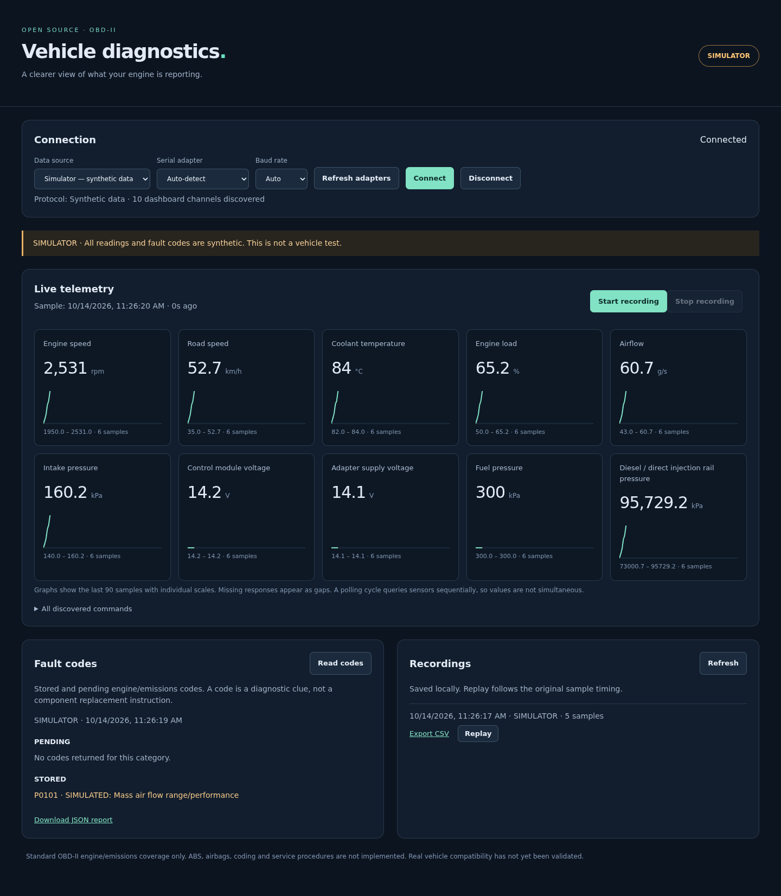

# Open Vehicle Diagnostics

A local Python dashboard for standard OBD-II engine and emissions diagnostics, using **python-OBD**. Includes live charts, supported-sensor discovery, stored/pending fault reports, SQLite recording, CSV export, timestamp-paced replay and an explicitly labelled simulator. No cloud account or internet connection is needed at runtime.

**Status: initial working version, simulator and mocked-adapter tests only. No real vehicle or vLinker FS USB validation has been performed.** Intended first vehicle: 2011 Ford Transit 2.2 T115 diesel. Other brands, including Fiat Sedici, are candidates wherever their ECUs expose standard OBD-II services; this is not a claim of tested compatibility.



## Install on Ubuntu / Debian

Python 3.11 or newer is required. Keep the checkout, virtual environment and recordings on your external drive. First verify that `/mnt/external` is a real mounted drive, not an ordinary directory on `/`:

```bash
findmnt -T /mnt/external/Projects -o SOURCE,TARGET,FSTYPE
lsblk -o NAME,TRAN,SIZE,FSTYPE,MOUNTPOINTS
```

For a fresh checkout (skip cloning if this folder already exists):

```bash
cd /mnt/external/Projects
git clone https://github.com/nicolomantini/open-vehicle-diagnostics.git
cd open-vehicle-diagnostics
sudo apt install python3-venv
python3 -m venv .venv
.venv/bin/python -m pip install -e '.[test]'
.venv/bin/python -m vehicle_diagnostics.web
```

Open **http://127.0.0.1:8765**. Choose **Simulator — synthetic data**, then **Connect**. Nothing connects to a vehicle automatically at startup. Use Ctrl+C in the terminal to stop the server.

For the existing installation:

```bash
cd /mnt/external/Projects/open-vehicle-diagnostics
.venv/bin/python -m vehicle_diagnostics.web
```

## Connect the vLinker FS USB

1. Plug the adapter into the vehicle and laptop; turn the ignition on. Use the dashboard while parked. Run the engine only in a suitably ventilated location.
2. If your account lacks serial access, run `sudo usermod -aG dialout "$USER"`, then log out and back in. Do not run the dashboard as root.
3. Choose **Vehicle — USB adapter**, refresh adapters and select the appropriate `/dev/ttyUSB*` or `/dev/ttyACM*` device. The list contains serial candidates, not confirmed OBD adapters. Auto detection is available; an explicit port avoids probing unrelated serial devices.
4. Start with automatic baud rate. If connection fails, select the baud rate configured for your adapter. Auto protocol selection is handled by python-OBD. Connection and supported-PID discovery can take several seconds.
5. Check the connection status, protocol and discovered commands. There is no automatic fallback to fake data. After an unplug or ignition loss, reconnect explicitly.

The upstream pyOBD README lists the vLinker FS USB as tested **with pyOBD**. That evidence does not validate this application, this Linux installation or either target vehicle. This application does not switch Ford HS/MS-CAN networks or implement Ford-specific module access.

## What the dashboard covers

| Channel | Standard query | Notes |
| --- | --- | --- |
| Engine speed / road speed | 01 0C / 01 0D | rpm / km/h |
| Coolant / calculated load | 01 05 / 01 04 | °C / % |
| Mass airflow / intake pressure | 01 10 / 01 0B | g/s / kPa |
| Control module voltage | 01 42 | ECU-reported voltage |
| Adapter supply voltage | ATRV | Adapter measurement, not an ECU PID |
| Fuel pressure | 01 0A | kPa; distinct from rail pressure |
| Direct-injection rail pressure | 01 23 | kPa; useful if a diesel ECU supports it |
| Stored / pending DTCs | 03 / 07 | Explicit read-only queries; no response is not “no faults” |

Only supported dashboard channels are polled. The expandable command list includes the broader set discovered by python-OBD, even if this dashboard does not render them. Supported does not guarantee a valid response at every instant. Missing values are shown as gaps, never fabricated as zeros. Three consecutive cycles without any ECU sensor response end the connection; individual null responses remain visible as missing data. An adapter can remain connected even when ECU services stop responding.

Polling is serial and sequential: sample timestamps mark completion of a polling cycle, not simultaneous measurement by all sensors. More sensors and slower protocols reduce the effective sample rate. Graphs retain 90 samples in the browser; recordings are durable and unbounded by that chart window.

**Not implemented:** ABS, airbags/SRS, body modules, manufacturer-specific DTC interpretations, coding, adaptations, actuator tests, service resets, DPF regeneration, fault clearing, freeze-frame UI, permanent DTCs or VIN identification. Standard OBD-II is not universal diagnostics. See [coverage and validation](docs/COVERAGE.md).

## Recording, export and replay

Connect a source and select **Start recording**. Each sample is committed to `data/recordings.sqlite3` in the project directory by default. Stop recording or disconnect to close the session. After an interruption, already committed samples remain available; sessions without an end time appear as “open / interrupted”. Export remains available for them.

Refresh the recordings list to update counts. **Export CSV** includes UTC timestamps, source mode (`vehicle` or `simulator`), units and empty cells for unanswered queries. **Replay** closes the live source, stops recording and plays the stored samples with their original timestamps and elapsed timing. Replay is visibly labelled with the original source. Restart a replay with its Replay button; Disconnect stops it. Pause, seeking, speed controls and external CSV import are not included yet. Fault reports are downloaded separately as JSON and are not part of sensor replay.

Do not unplug the drive while the server is running. Recordings and local environment files are ignored by Git. `--data-dir` can select another storage directory; choose a location on the external drive to retain the storage requirement.

## Phone access on a trusted local network

The default server listens only on loopback. For deliberate access from a phone on the same trusted Wi-Fi, substitute the laptop's LAN IP:

```bash
.venv/bin/python -m vehicle_diagnostics.web --host 0.0.0.0 --trusted-host 192.168.1.50
```

Open `http://192.168.1.50:8765` on the phone. The host allowlist and per-process request token protect against browser cross-site commands; **they are not user authentication**. Anyone able to access the dashboard can view data and control this read-only diagnostic session. This initial Flask server is intended for local use, with no HTTPS or multi-user isolation. Do not forward its port or expose it to the internet. All browsers share one adapter, recording and replay state.

## Development

```bash
.venv/bin/python -m pytest -q
```

Tests cover supported-query filtering, unit conversion, missing data versus empty fault lists, connection failures, polling failures, recording durability, provenance, CSV nulls, replay timing, HTTP validation and cross-site request protection. CI runs on Python 3.11 and 3.13. See [architecture](docs/ARCHITECTURE.md) for the backend extension boundary.

## Licence and upstream research

GPL-2.0-only; see [LICENSE](LICENSE). Fresh application code uses python-OBD as a dependency. No pyOBD code or assets were copied. The upstream capability and licence review is documented in [THIRD_PARTY.md](THIRD_PARTY.md), including primary-source links. The tested communication dependency is pinned to `obd==0.7.3`.
